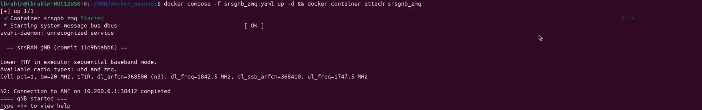
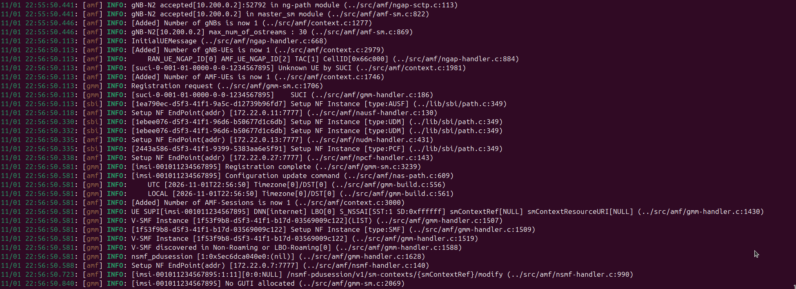
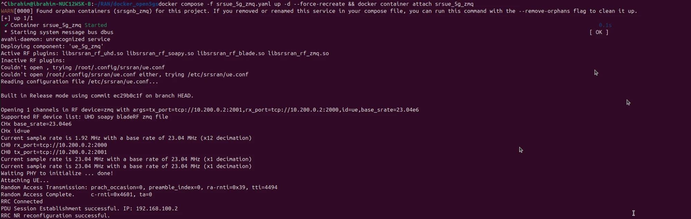
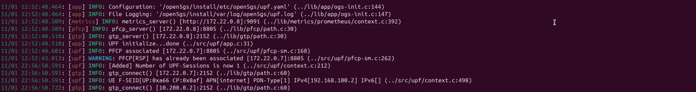
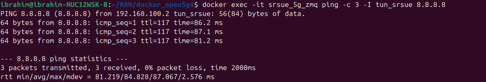
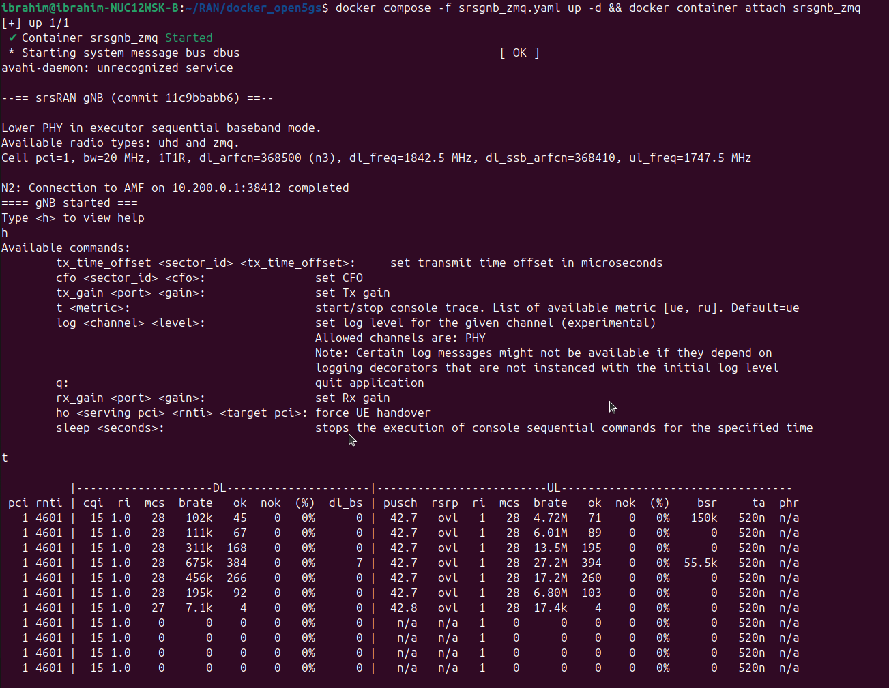
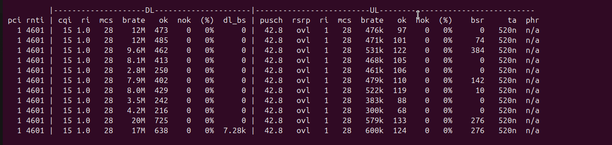

# hybrid-5g-lab

A hybrid 5G standalone lab: the **Open5GS core runs on AWS EC2**, the **srsRAN gNB + srsUE (ZeroMQ, no radio hardware) run at home**, and the two are joined by a **WireGuard tunnel**.

## Architecture

```
          Home (Docker, network_mode: host)                         AWS EC2 (eu-north-1)
 ┌──────────────────────────────────────────┐            ┌──────────────────────────────────────┐
 │  srsUE ──ZMQ (tcp 2000/2001)── srsgNB     │            │  Open5GS 5GC (docker_open5gs)        │
 │                                  │        │            │   AMF  :38412/sctp  (N2)             │
 │                                  │ N2/N3  │            │   UPF  :2152/udp    (N3)             │
 │                         wg0 10.200.0.2 ───┼── UDP ────►│ wg0 10.200.0.1   :51820/udp          │
 └──────────────────────────────────────────┘  WireGuard └──────────────────────────────────────┘
                                                            WebUI http://10.200.0.1:9999 (VPN only)
```

- **Core (`terraform/`)**: VPC, public subnet, security group (only WireGuard 51820/udp is public; SSH optional for one admin CIDR), Ubuntu EC2 with Elastic IP. `user_data.sh.tpl` installs WireGuard, SCTP, Docker, clones `docker_open5gs`, advertises AMF/UPF on the tunnel address and starts `sa-deploy.yaml` with N2/N3 published.
- **RAN (`ran/`)**: only the files changed from upstream [`herlesupreeth/docker_open5gs`](https://github.com/herlesupreeth/docker_open5gs) live in `ran/overrides/`; `ran/UPSTREAM` pins the upstream commit and `ran/setup.sh` re-clones and overlays them.
  - `srsgnb_zmq.yaml`, `srsue_5g_zmq.yaml`: host networking instead of the core's Docker bridge, so the gNB reaches the AMF over `wg0`.
  - `srslte/Dockerfile`: skips `uhd_images_downloader` (no USRP needed with ZMQ).
  - `env.example` → `.env`: `AMF_IP=10.200.0.1`, gNB/UE/host IP `10.200.0.2`. SIM `UE1_KI`/`UE1_OP` are `CHANGE_ME` and are filled from upstream's public test defaults by `setup.sh`.

## Quick start

### 1. WireGuard keys
```bash
wg genkey | tee aws.key | wg pubkey > aws.pub
wg genkey | tee home.key | wg pubkey > home.pub
```
(Key files are git-ignored; keep them outside the repo anyway.)

### 2. Core on AWS
```bash
cd terraform
cp terraform.tfvars.example terraform.tfvars   # set aws_wg_private_key = aws.key, home_wg_public_key = home.pub
terraform init && terraform apply
terraform output wireguard_home_config         # template for /etc/wireguard/wg0.conf at home
```
Fill in `<HOME_PRIVATE_KEY>` (home.key) and `<AWS_PUBLIC_KEY>` (aws.pub), then `sudo wg-quick up wg0` and `ping 10.200.0.1`. First boot takes a while; it is finished when `/home/ubuntu/DEPLOY_DONE` exists. Terraform also writes the SSH key `open5gs-lab-key.pem` into `terraform/` (git-ignored).

Add the subscriber (IMSI `001011234567895`, K/OP from your `.env`) in the WebUI at `http://10.200.0.1:9999`.

### 3. RAN at home
```bash
cd ran
./setup.sh                    # clones upstream into ran/docker_open5gs and overlays changes
cd docker_open5gs

# Prebuilt srsRAN images from upstream (GitHub Container Registry).
# The compose files use the short names, so tag them after pulling.
docker pull ghcr.io/herlesupreeth/docker_srslte:master
docker tag ghcr.io/herlesupreeth/docker_srslte:master docker_srslte
docker pull ghcr.io/herlesupreeth/docker_srsran:master
docker tag ghcr.io/herlesupreeth/docker_srsran:master docker_srsran

docker compose -f srsgnb_zmq.yaml up -d
docker compose -f srsue_5g_zmq.yaml up -d
```
Note: `:master` images follow upstream's latest build, not the commit pinned in `ran/UPSTREAM`, and they include the USRP firmware that `overrides/srslte/Dockerfile` skips (harmless with ZMQ). To build from the pinned sources instead, run `docker build -t docker_srslte .` in `srslte/` and `docker build -t docker_srsran .` in `srsran/`.

Check `docker logs srsue_5g_zmq` for a PDU session, then test with `ping -I tun_srsue 8.8.8.8`.

### Tear down
```bash
cd terraform && terraform destroy
```

## Proof of concept

End-to-end run of this setup: srsRAN gNB and srsUE at home, Open5GS core on AWS, connected over WireGuard (`10.200.0.2` ↔ `10.200.0.1`).

**1. gNB connects to the AMF on AWS over the tunnel (N2/SCTP)**: `N2: Connection to AMF on 10.200.0.1:38412 completed`



**2. AMF accepts the gNB and registers the UE** (IMSI `001011234567895`, DNN `internet`, S-NSSAI SST 1)



**3. UE attaches over ZMQ**: random access, RRC connected, PDU session established with IP `192.168.100.2`



**4. UPF creates the session and opens GTP-U (N3) to the gNB at `10.200.0.2:2152`**



**5. User-plane traffic reaches the internet through the AWS core**: 0% packet loss, ~85 ms RTT



**6–7. gNB metrics**: CQI 15, MCS 28, no HARQ errors (`nok` 0); DL up to ~20 Mbit/s and UL up to ~27 Mbit/s





## Roadmap
- [ ] Remote Terraform state (S3 + DynamoDB lock) instead of local state
- [ ] Provision the test subscriber automatically (mongo/`open5gs-dbctl`) from user data
- [ ] Generate WireGuard keys / home `wg0.conf` automatically, keep secrets in SSM Parameter Store
- [ ] CI: `terraform fmt/validate`, `shellcheck`, secret scanning on every push
- [ ] Multiple UEs and a second gNB; slicing (SST/SD) experiments
- [ ] Monitoring: Prometheus/Grafana for core metrics reachable over the VPN
- [ ] Real radio (USRP/bladeRF) path alongside ZMQ
